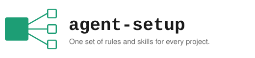

<p>
  <picture>
    <source media="(prefers-color-scheme: dark)" srcset="docs/img/banner-dark.svg">
    <source media="(prefers-color-scheme: light)" srcset="docs/img/banner-light.svg">
    
  </picture>
</p>

# agent-setup

[](https://github.com/iantutunaru/ai-agent-setup/actions/workflows/tests.yml)

agent-setup is one shared set of rules and skills for AI coding assistants. You install it once, and every
project on your machine loads the same rules and skills, so a fix made once reaches every project. This is a
public copy of the owner's working setup, made on 2026-11-22 and updated by hand. It was built for Claude Code on
Windows and also runs in the ChatGPT desktop app and in Codex.

What you get:

- **Rules** ([global/rules.md](global/rules.md), with a short part for each tool beside it), loaded in every
  chat: claims rest on facts, decisions belong to you and are asked in rounds of questions that each carry a
  recommendation, the assistant never sends anything for you, secrets stay out of git, how large a chat may
  grow, which model does which work, how commits are written.
- **Two profiles** ([profiles/](profiles/)): extra rules for code projects and for document projects. A project
  picks one with a single line.
- **19 skills** ([global/skills/](global/skills/)): instructions the assistant loads when a task calls for them,
  some with small scripts. They are listed under "The skills" below.
- **A project template** ([template/](template/)): the starting files of a new project.
- **Settings** ([global/settings.json](global/settings.json)) for Claude Code: UTF-8 for Python, two plugins,
  and a step that pulls this repo at the start of every session. ChatGPT gets the same pull from a hook its
  install script adds.

## Which assistants

| Assistant | What works |
|---|---|
| Claude Code | Everything. |
| ChatGPT desktop app, Codex (command line, editor extension) | The 19 skills, the rules (built into ChatGPT's own rules file), the pull at the start of a chat, the template and the three setup skills, through [install-chatgpt.ps1](install-chatgpt.ps1). Tested in the app in three rounds. |
| ChatGPT in the browser or on a phone | Not supported. It does not read skill folders: skills there are for Business, Enterprise, Healthcare and Edu plans and are added by hand ([OpenAI's help page](https://help.openai.com/en/articles/20001066-skills-in-chatgpt), read 2026-11-21). You can still paste the text of a writing skill's `SKILL.md` into a chat as instructions. |

How far each part has been tried, by group. The words follow from the full table in
[docs/tried.md](docs/tried.md), which says for every skill what ran and what did not:

| Part | Claude Code | ChatGPT desktop app |
|---|---|---|
| Writing | partly tried | partly tried |
| Web design | tried | partly tried |
| Game design | partly tried | not tried |
| Running a project | partly tried | not tried |
| Setup | partly tried | partly tried |
| The rules and the session-start hook | partly tried | partly tried |

## Install

You need:

- Windows with PowerShell. The install scripts link folders with junctions, which need no admin rights.
- Git for Windows. For ChatGPT, 2.53 or newer (see the warning below).
- Python 3 on the path. The scripts use only what ships with Python.
- For the whole setup in Claude Code, two plugins the rules rely on: `mattpocock-skills` (its question round
  skill, which the rules run before every round of questions) and `humanizer`. The install adds both and their
  sources to your Claude settings; check in Claude Code that they are installed.
- For the whole setup in ChatGPT, the same question round skill (`grilling`). Its author's README gives two
  commands for Codex: `codex plugin marketplace add mattpocock/skills`, then
  `codex plugin add mattpocock-skills@mattpocock` (github.com/mattpocock/skills, read 2026-11-21).

> [!WARNING]
> For ChatGPT, use Git 2.53 or newer. Inside ChatGPT's sandbox an older Git refuses every project ("dubious
> ownership"; 2.44.0 does, 2.53.0 and 2.56.1 do not, the lowest version that works is not determined).
> `install-chatgpt.ps1` warns about an old one.

You can also fork the repo on GitHub first and clone your fork. Then the setup is yours: change the rules and
skills as you like, and your PC pulls from your fork.

Then set up one assistant, or both side by side. Open the one you use:

<details>
<summary><strong>Claude Code</strong></summary>

1. Clone the repo, or your fork of it, into the folder that holds your projects. Cloning makes your own working
   copy of the repo on your PC; your setup runs straight from it, and every chat pulls the latest version into
   it.

   ```powershell
   git clone https://github.com/iantutunaru/ai-agent-setup.git
   ```

2. From the repo's folder, run the install:

   ```powershell
   powershell -ExecutionPolicy Bypass -File install.ps1
   ```

3. Fill in your two files in `local/`, which the install made from the examples. They live in a folder of the
   clone that git ignores, so they never reach the repo and nobody else sees them:
   - `local/personal.md`, from [global/personal.example.md](global/personal.example.md): a few lines about you.
     Its Preferences (language, background, which model, chat size) win over the shared rules; a project's own
     file wins over them, and no personal file switches off a hard rule.
   - `local/settings.personal.json`, from
     [global/settings.personal.example.json](global/settings.personal.example.json): what Claude's auto mode
     should know about your machines and accounts. Keep `{{PROJECTS}}` where the folder that holds your projects
     belongs; the install fills it in. While it is still the example, the install does not merge it.
4. Run the install again, so it merges your settings. It is safe to run again at any time.

</details>

<details>
<summary><strong>ChatGPT desktop app and Codex</strong></summary>

1. Do step 1 of the Claude Code steps: clone the repo, or your fork of it.
2. From the repo folder run:

   ```powershell
   powershell -ExecutionPolicy Bypass -File install-chatgpt.ps1
   ```

3. Fill in `local/personal.md`, which the script made from
   [global/personal.example.md](global/personal.example.md): the lines about you (step 3 of the Claude Code
   steps).
4. Restart the ChatGPT desktop app.
5. Trust the new hook once (the note below says where).

</details>

> [!IMPORTANT]
> In ChatGPT, trust the new hook once: Settings, Hooks. ChatGPT skips a hook until you have reviewed it.

What each install script backs up and changes on your PC, a second PC, how to undo the ChatGPT install, and how
to take a single skill: [docs/install.md](docs/install.md).

## Why

**Copies drift apart.** Each project collects its own copy of your rules and helper skills, and the copies
drift apart. Here there is one copy: an install script links this repo into the assistant's settings folder
(one script for Claude Code, one for ChatGPT), so every project on the machine reads the same files. A new
project starts from the [template](template/).

**The assistant guesses.** "Facts, not assumptions" in the [shared rules](global/rules.md): every claim rests on
something measured, read, tested or sourced, and the assistant labels what it does not know as unknown and finds
it out before building on it. In research files each claim carries its source and a label: verified, search snippet
only, inference, sources conflict, not found.

**The assistant decides or sends for you.** "Decisions are the user's" in the [shared rules](global/rules.md):
the assistant asks in rounds of questions, each with a recommendation, and logs every answer in the project's
decisions log. "The assistant never sends": it drafts messages, emails and forms in the chat, and you send
them.

**Chats grow too long.** The Chats part of the [shared rules](global/rules.md) gives each chat a planned size.
Past a quiet zone no new question opens. Before the planned size the assistant writes a hand-over (what is done,
what is left, the gotchas), commits and stops, and a fresh chat goes on from it.

## The skills

A skill is a folder with a `SKILL.md` file. The assistant sees one line about each skill and loads the whole
file when your request fits it, so most of the time you just ask for what you want. You can also name a skill:
in Claude Code type `/` and its name; in the ChatGPT desktop app type `@` and pick it; in Codex type `$` or
`/skills`.

### Writing

For text other people will read. humanizer-en is from
[matematicsolutions](https://github.com/matematicsolutions/matematic-humanizer), MIT licence; the five after it
are from [surendranb/writing-skills](https://github.com/surendranb/writing-skills), MIT licence, each one page of
instructions with no script. Where each came from: [README-sources.md](global/skills/README-sources.md).

| Skill | What it does | Say |
|---|---|---|
| [writing-check](global/skills/writing-check/SKILL.md) | Drafts and checks emails, messages, letters, listings, reports. One script flags dashes and banned words, another reports sentence length, passive voice and reading ease; the assistant then reads the text against [writing-rules.md](global/skills/writing-check/writing-rules.md). It starts when you ask for outgoing text. A project can add its own rules in `style/writing-rules.md`. | "Draft a reply to this email and run the writing check." |
| [humanizer-en](global/skills/humanizer-en/SKILL.md) | Removes the marks of machine writing (inflated wording, stock phrases, rule of three, dashes) while keeping what the text says. | "Humanize this paragraph." |
| [plain-language](global/skills/plain-language/SKILL.md) | Shorter, simpler wording by the US plain language guidelines. | "Put this in plain English." |
| [business-writing](global/skills/business-writing/SKILL.md) | Memos, status updates and decision briefs with the conclusion first. | "Write a status update for my manager from these notes." |
| [corporate-communication](global/skills/corporate-communication/SKILL.md) | Announcements, organisation changes and policy news inside a company. | "Draft the announcement of the office move." |
| [orwells-rules](global/skills/orwells-rules/SKILL.md) | George Orwell's six rules, for cutting stale phrases, jargon and padding. | "Apply Orwell's rules to this." |
| [gov-uk-style](global/skills/gov-uk-style/SKILL.md) | Public help pages and policy summaries in the GOV.UK style. | "Rewrite this help page in GOV.UK style." |

### Web design

These four work from a rulebook of about 1,700 short entries drawn from the owner's design books. Each
entry restates the advice in new words and gives the book and page it rests on. It says what to do, and whether it is
a **rule** (a study or a current source stands behind it) or a **practice** (an author's working habit).
Answers and findings cite entries by id, such as `forms-012`, so you can check them. The rulebook lives in
[research/web-design/rulebook/](research/web-design/rulebook/); the working notes it was built from and the
books' own text are not in the repo. The web skills need the whole repo on the machine, not just their own
folders, because the rulebook lives in `research/`. If a project has its own ideas file (`docs/web-ideas.md`),
web-look puts its matching ideas on the table too.

| Skill | What it does | Say |
|---|---|---|
| [web-rulebook](global/skills/web-rulebook/SKILL.md) | Answers questions from the rulebook. It also holds the lookup script the other three use. | "Is there a rule on how long a line of text should be?" |
| [web-look](global/skills/web-look/SKILL.md) | For the moment before a page or a part of one is drawn: two to four options that differ where the books leave a real choice, each saying which entries it follows and which it bends. | "Give me options for where the filters go on the search page." |
| [web-check](global/skills/web-check/SKILL.md) | Checks a built page, a mock-up or a screenshot. On a running page it measures first (text sizes, contrast, line length, tap targets, headings, images, forms, speed), then gives every entry that applies a verdict, with a fix for each fault. It needs a browser the assistant can drive; without one it reads the sizes from the code and says so. | "Check the contact form." |
| [web-text](global/skills/web-text/SKILL.md) | Writes and checks the words on a page: headings, button labels, form errors, descriptions. It ends with the writing-check scripts. | "Write the labels and error messages for this form." |

### Game design

For game projects. They work from the owner's game design books (Schell, Sellers, Fullerton, Rogers),
summarised in each skill's `references/` with the book and chapter of every idea; the books' own text is not in
the repo. Each reads a **Game design** entry in the project's instruction file (its pillars file, data folder,
backlog, playtest folder, batch command and fairness target) and stops if there is none; `/setup-sync` adds it.
The entry's fields and where the books live: [research/game-design/README.md](research/game-design/README.md).
Five game programming skills (bot AI, simulation patterns, unit movement, lockstep desyncs, frame budget) are
being made engine-neutral and will join these (SU-Q78).

| Skill | What it does | Say |
|---|---|---|
| [design-lenses](global/skills/design-lenses/SKILL.md) | Judges a mechanic or prepares a design round: picks the two to four book lenses that tell the options apart, answers them against the project's facts, and ends each recommendation with the pillar and lens it rests on. | "Look at the new hazard with our design lenses." |
| [balance-check](global/skills/balance-check/SKILL.md) | Measures fairness and viable options with headless matches and gives a verdict instead of a percentage: its script turns a win count into `fair`, `unbalanced`, `unclear, run about N more` or `borderline` against the project's band. It separates the game from the bot before calling anything unbalanced, and proposes changes for you to accept rather than tuning. | "Is the north side winning too often?" |
| [playtest-plan](global/skills/playtest-plan/SKILL.md) | Plans a session of you playing: at most three questions, each with a prediction written before play, a one-screen plan and a notes sheet. Afterwards it asks the after-match questions and files every note as a verdict, a watch-list entry or a backlog candidate. | "I'm about to play against the bot, what should I look for?" |

### Running a project

For work that spans chats: rounds only you can do, and the close of a stage of tickets.

| Skill | What it does | Say |
|---|---|---|
| [guided-session](global/skills/guided-session/SKILL.md) | For a round of steps only you can do: playing a build, working at a device, reading values in a running program. The assistant writes a short checklist, one thing to observe per row, takes your one-line reply, records the results and turns failed rows into a fix list. | "Prepare a test round for this ticket." |
| [stage-close](global/skills/stage-close/SKILL.md) | Closes a stage of work in its own chat: a look back at how each ticket went against its estimate, a revised ticket list for your approval, cleanup of merged branches and leftovers, tidy docs, a commit. It reads where a project keeps these things from a "Stage close" list in the project's instruction file, and stops if there is none. | "Close the stage." |

### Setup

These three run only when you name them: `/setup-init` in Claude Code, `$setup-init` (or `@` and its name) in
ChatGPT.

| Skill | What it does | Say |
|---|---|---|
| [/setup-init](global/skills/setup-init/SKILL.md) | Starts a new project in an empty folder: three questions (code or documents, name and purpose, a short prefix for ticket ids), and for a code project two more (is it a game, where will you test by hand), then the template files and a first commit. | `/setup-init` |
| [/setup-sync](global/skills/setup-sync/SKILL.md) | Brings an existing project in line with this repo, or moves an old project onto it. It lists every change it proposes, asks, and makes one commit. | `/setup-sync` |
| [/setup-promote](global/skills/setup-promote/SKILL.md) | Moves an improvement you made in one project into this repo, so every project gets it. It makes a branch, commits, pushes the branch (never `main`) and shows the link where you open the pull request. Run it again after the merge: it switches the setup back to `main`. | `/setup-promote` |

## Day to day

- **Change things here, not in a project.** Edits in `global/` and `profiles/` apply to every project at once,
  and to every PC that installed it once they are merged. An improvement found in a project comes here with
  `/setup-promote`; "Working together" in [CONTRIBUTING.md](CONTRIBUTING.md) says how a change lands.
- **Every session starts with a pull.** A small script pulls `main` at the start of every session, so your PC
  gets every merged change. It prints one line when it cannot pull, when changes are uncommitted, or while the
  setup is on a branch (and once that branch is merged, so you run `/setup-promote` to switch back).
- **A project joins** with two files. `AGENTS.md` holds the project's own text and names its profile
  (`Profile: code` or `Profile: docs`); both assistants read it. `CLAUDE.md` is two import lines that let Claude
  Code load the profile and `AGENTS.md`. `/setup-init` and `/setup-sync` write both for you.

## More

- [CONTRIBUTING.md](CONTRIBUTING.md): how this copy relates to the owner's own repo, how a change is made, the
  tests, the notes for whoever maintains the repo, and its layout.
- [docs/install.md](docs/install.md): what the install scripts change on your PC.
- [docs/tried.md](docs/tried.md): what has been tried where, skill by skill.
- [decisions.md](decisions.md): every decision about this setup and its reasons, with ids `SU-Qnn`.
- [LICENSE](LICENSE): the licence, and what it does not cover.

## Licence

The owner's own code and text are under the MIT licence ([LICENSE](LICENSE)). The six skills from GitHub keep
their own licences, which are in their folders; where each came from is in
[README-sources.md](global/skills/README-sources.md). The `research/` folder is not covered by the licence: it
summarises published books, which belong to their authors and publishers.
